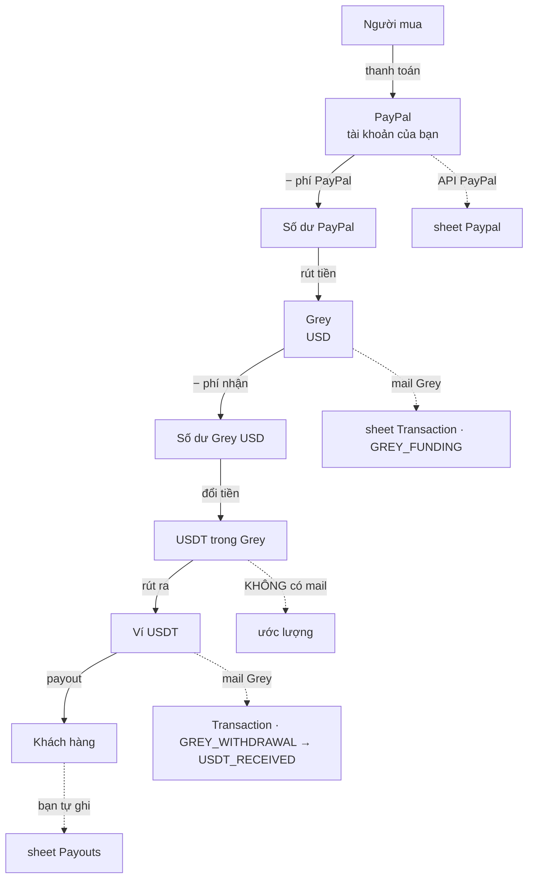

# Dòng tiền: PayPal → Grey → USDT

Tài liệu tham chiếu cho hệ thống Payment All. **Không thuộc project Apps Script** — file `.md` không nằm trong `scriptExtensions` nên `clasp push` bỏ qua.

---

## 1. Toàn cảnh



Đường liền là tiền đi. Đường đứt là **hệ thống nhìn thấy bằng cách nào**.

---

## 2. Từng chặng

### Chặng 1 — Người mua → PayPal

| | |
|---|---|
| Nguồn dữ liệu | **API PayPal**, `syncPayPalAllAccounts()` chạy 6h và 18h |
| Ghi vào | sheet `Paypal` |
| Chi phí | **phí PayPal** — đo được, PayPal báo từng giao dịch |
| Ai là chủ | khách hàng, xác định qua **Invoice Prefix** trong mã đơn |

Mỗi giao dịch thành một dòng `Customer Ledger`:

```
Gross Amount − PayPal Fee − Refund Amount = Net Amount
```

`Net Amount` là **tiền của khách**, tính bằng USD.

> **HOLD không phải refund.** Mã sự kiện `T1110` là tiền bị giữ tạm, không trừ vào tiền khách.

---

### Chặng 2 — PayPal → Grey

| | |
|---|---|
| Nguồn dữ liệu | mail Grey `Wallet Funding Successful` |
| Ghi vào | `Transaction` · `GREY_FUNDING` |
| Chi phí | **phí nhận của Grey** — **đo được** |

Mail Grey ghi rõ hai số:

```
Amount tendered:  $55.33     ← rời PayPal
Amount received:  $53.33     ← vào Grey
                  ───────
phí nhận            $2.00
```

Phí này được chia cho từng khách theo tỷ lệ tiền của họ trong lần rút, thành cột `Receiving Fee Allocated` trên `Customer Allocation`.

**Đây là chặng quyết định quyền sở hữu.** Khi withdrawal PayPal khớp được với dòng Grey tương ứng, allocation chuyển sang `AVAILABLE` — và chỉ tiền `AVAILABLE` mới xuất hoá đơn được.

---

### Chặng 3 — Đổi USD sang USDT trong Grey

| | |
|---|---|
| Nguồn dữ liệu | **không có** — Grey không gửi mail về lần convert |
| Chi phí | `Conversion Rate` trong sheet `Fee Rules` — **ước lượng** |

Đây là chặng duy nhất hệ thống hoàn toàn mù. Hai chỗ bù lại, và chúng độc lập nhau:

- **Sổ khách** dùng `Conversion Rate` để trừ chi phí khỏi tiền khách
- **Ngân quỹ** dùng `FLOW_CFG.USD_TO_USDT_RATE = 0.998` để ước số dư USD còn lại của Grey

Con `0.998` chỉ chảy vào đúng một ô `Estimated USD Balance` trên sheet Grey. **Không chỗ nào đọc lại nó** — nó không điều khiển quyết định nào.

---

### Chặng 4 — Grey → Ví USDT

| | |
|---|---|
| Nguồn dữ liệu | mail Grey `Withdrawal Successful`, currency USDT |
| Ghi vào | `Transaction` · `GREY_WITHDRAWAL` → Flow suy ra `USDT_RECEIVED` |
| Chi phí | `Transfer Rate` / `Transfer Minimum` — **ước lượng** |

Ví đích lấy từ cột `Default USDT Account` của tài khoản Grey.

> **Rút ra ví ngoài hệ thống:** máy vẫn ghi có cho ví mặc định. Cách xử lý hiện tại là tạo một dòng Payouts `ADJUSTMENT` để bù trừ.

`Transfer Minimum` tồn tại vì phí rút on-chain là **phí phẳng theo lần**, không theo số tiền:

```
Transfer Cost = max(số tiền × Transfer Rate, Transfer Minimum)
```

Với `Minimum = 1.00` và `Rate = 0.0025`, mức sàn còn chi phối tới khi hoá đơn vượt **400**.

---

### Chặng 5 — Ví USDT → Khách

| | |
|---|---|
| Nguồn dữ liệu | **bạn tự ghi** — sheet `Payouts` |
| Chi phí | `Payout Fee %` — không phải chi phí, mà là **phần của bạn** |

Hoá đơn tạo dòng Payouts ở trạng thái `DRAFT`. `DRAFT` **không trừ số dư** — nó là ý định. Chỉ khi bạn đổi sang `PAID` thì Flow mới dựng transaction và tiền mới thật sự rời đi.

---

## 3. Bảng chi phí

| Chi phí | Ai thu | Đo hay ước | Hiện ở đâu trên hoá đơn |
|---|---|---|---|
| Phí PayPal | PayPal | **đo** | `PayPal Fees` |
| Phí nhận Grey | Grey | **đo** | gộp vào `Transfer Fees` |
| Đổi USD→USDT | Grey | ước | gộp vào `Transfer Fees` |
| Rút USDT | mạng blockchain | ước | gộp vào `Transfer Fees` |
| Phí dịch vụ | **bạn** | cấu hình | `Payout Fee (x%)` |

Ba khoản giữa gộp thành **một dòng** `Transfer Fees` cho khách dễ đọc. Cột `Downstream Cost` trên sheet **cố ý không hiện** trên PDF — nó chính bằng `Conversion + Transfer`, in thêm là khách tưởng bị thu hai lần.

---

## 4. Ví dụ bằng số thật

Khách DITECH, tiền khả dụng **258,67 USD**:

```
Available Amount                    258,67
  − Conversion Cost   258,67 × 0,002 =   0,52
  − Transfer Cost     max(0,52 · 1,00) =   1,00   ← sàn ăn
                                    ─────────
  Downstream Cost                       1,52
Net Before Payout Fee                 257,15
  − Payout Fee 5%                      12,86
                                    ─────────
AMOUNT DUE                            244,29
```

Trả cho khách **244,29** — ghi là USDT.

---

## 5. Vì sao "USDT" chỉ là cái nhãn

**Không có phép đổi tiền nào trong chuỗi tính của khách.** `Conversion Rate` và `Transfer Rate` sinh ra **chi phí bị trừ**, không quy đổi đơn vị.

Nên `Amount Due` là một số USD, và `payoutCurrency: 'USDT'` là nhãn — dựa trên USD ≈ USDT 1:1. Cả hệ thống chỉ có hai đơn vị này.

Hệ quả: cột `Advance Outstanding` trên sheet Customers mang nhãn USDT trong khi các cột khác là USD, nhưng **cùng một con số**.

> Nếu sau này có đơn vị thứ ba không neo 1:1, chỗ vỡ đầu tiên là `custDefaultPayoutCurrency_` — nó trả `'USDT'` cho provider USDT bất kể tiền gốc là gì.

---

## 6. Quyền sở hữu của khách dừng ở đâu

**Chặng 2.** Khi withdrawal PayPal khớp được với provider nhận, allocation thành `AVAILABLE` và tiền đó thuộc về khách.

Mọi thứ sau đó — Grey→USDT, ví sang ví, gộp chung, chia lẻ — là **ngân quỹ**, không quyết định điều kiện xuất hoá đơn.

Đó là lý do số dư USDT sai cũng không làm lệch một đồng nào của khách.

### Hai mốc thời gian, không phải một

| | ý nghĩa |
|---|---|
| `To Date` | ngày **bán** — giao dịch PayPal xảy ra tới ngày nào |
| `As-Of Date` | ngày **tiền về** — đã tới provider nhận tính tới ngày nào |

Tiền bán trong kỳ nhưng về sau As-Of thì **chưa đủ điều kiện**. Chạy lại kỳ cũ với As-Of hôm nay sẽ ra số lớn hơn hồi đó — đúng, không phải lỗi.

### Phân bổ mới-trước

Một lần rút được lấp bằng **giao dịch mới nhất** của khách trước, không phải cũ nhất. Allocation thuộc hoá đơn đã phát hành thì **khoá cứng**, phát lại nguyên văn ở mọi lần dựng — nên đổi chính sách phân bổ không xê dịch lịch sử.

---

## 7. Những chỗ hệ thống không nhìn thấy

Liệt kê thẳng, vì biết giới hạn quan trọng hơn tin vào con số.

| Không thấy | Hậu quả | Bù bằng gì |
|---|---|---|
| Lần đổi USD→USDT trong Grey | không đo được chi phí thật | `Conversion Rate` và `0.998` |
| Chuyển tiền giữa hai ví USDT | phân bổ theo ví sai | đọc **dòng tổng** ở `USDT!A1`, đừng đọc từng ví |
| Số dư ví USDT thật | không có nguồn đối chiếu | `USDT!A1` là *"hệ thống ghi nhận"*, không phải *"trong ví có"* |
| Grey rút ra ví ngoài | ghi có nhầm cho ví mặc định | dòng Payouts `ADJUSTMENT` bù trừ |
| Tiền vào ví từ nguồn khác | không tự biết | sheet `Manual In` |

Và một điều dễ quên: **collector Grey chạy ở project Apps Script khác**. Nó chết thì bên Payment All không hay biết gì — dữ liệu chỉ đơn giản ngừng mới. Cột `Last Sync` trên sheet Grey là cách duy nhất nhìn thấy điều đó, và báo cáo sáng hằng ngày có kiểm nó.

---

## 8. Lịch chạy

```
~1h    collector Grey        (project hộp thư trung tâm)
~6h    syncPayPalAllAccounts()
~7h    syncFlow() → syncCustomers() → báo cáo Telegram
~18h   syncPayPalAllAccounts()
~19h   syncFlow() → syncCustomers()
```

`atHour()` chạy đâu đó **trong** khoảng một tiếng, không đúng phút.

**Không trigger nào tạo hoá đơn.** Chuỗi dừng ở `syncCustomers()` — toàn bộ lớp an toàn preview-trước-create dựa vào việc có người nhìn số trước khi bấm.
